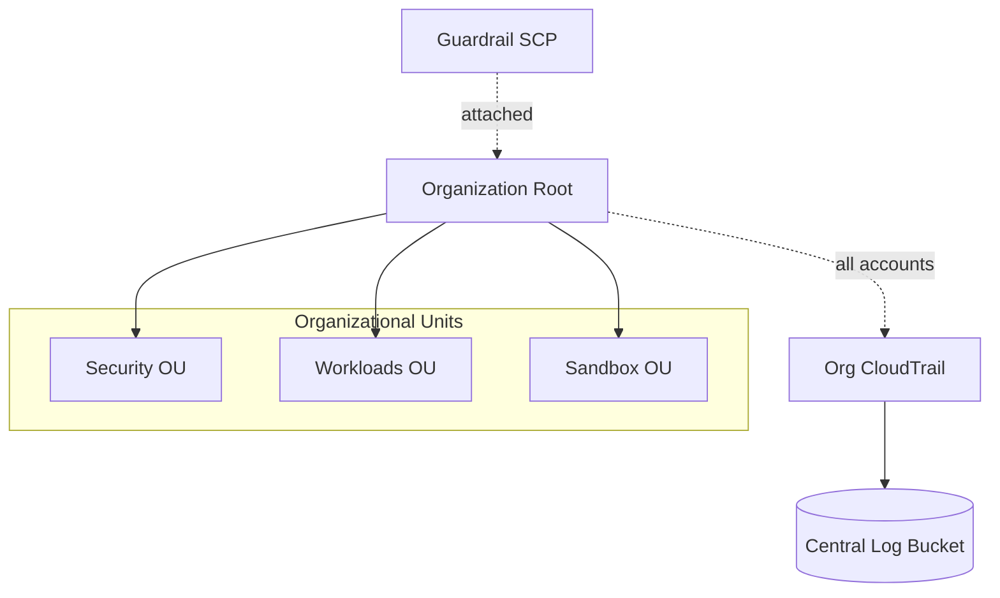

# AWS Multi-Account Landing Zone (Terraform)

> Foundational governance: AWS Organizations with OUs, a guardrail SCP, and org-wide CloudTrail logging — provisioned with Terraform.
> **Author:** Muhammad Ahmad · **IaC:** Terraform · **Cloud:** AWS


---

## 📌 Overview

The backbone of a secure multi-account AWS setup:

- **AWS Organizations** (all features) with Service Control Policies enabled.
- **Organizational Units** — `Security`, `Workloads`, `Sandbox` — to group accounts by purpose.
- A baseline **SCP guardrail** that denies leaving the org and denies stopping/deleting CloudTrail.
- **Organization-wide CloudTrail** writing to a centralized, private, log-validated S3 bucket.

## 🏗️ Architecture

> 🎨 **Interactive diagram (industry-standard icons):** [open in Lucid — page 7](https://lucid.app/lucidchart/3da75ce3-ea66-4296-81b3-00d20a60435b/edit)



## ⚠️ Prerequisites

Run this from the **Organizations management (payer) account**. It manages the organization itself, so apply it where you have org admin rights.

## 🚀 Deploy

```bash
cd terraform
terraform init
terraform apply
```

## 🧹 Clean up

```bash
terraform destroy
```

## 🔐 Production hardening (next steps)

- Add **region-restriction** and **root-user-protection** SCPs.
- Add **AWS Config** org aggregator and conformance packs.
- Add dedicated **Log Archive** and **Audit** accounts (Control Tower style).

---

*Built and maintained by **Muhammad Ahmad**.*
