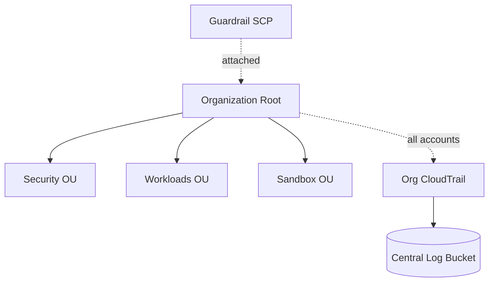

# Architecture Diagram — AWS Multi-Account Landing Zone

## Lucid diagram

- **View:** https://lucid.app/lucidchart/29abd1c6-cdd2-4146-afe6-22f3e759f069/view
- **Edit:** https://lucid.app/lucidchart/29abd1c6-cdd2-4146-afe6-22f3e759f069/edit

## Lucid prompt (reusable)

```
Create an AWS governance diagram titled "AWS Multi-Account Landing Zone".
Show an Organization Root at the top with a Guardrail SCP attached to it. Below the
root, three Organizational Units: Security, Workloads, Sandbox. Also show an
Organization CloudTrail that collects from all accounts and writes to a central S3
log bucket. Clean, professional AWS colors.
```

## Mermaid source


